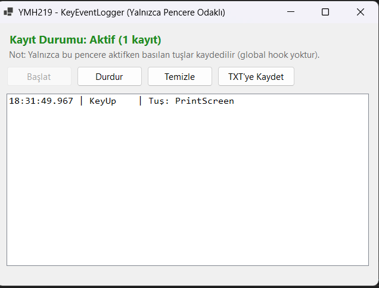
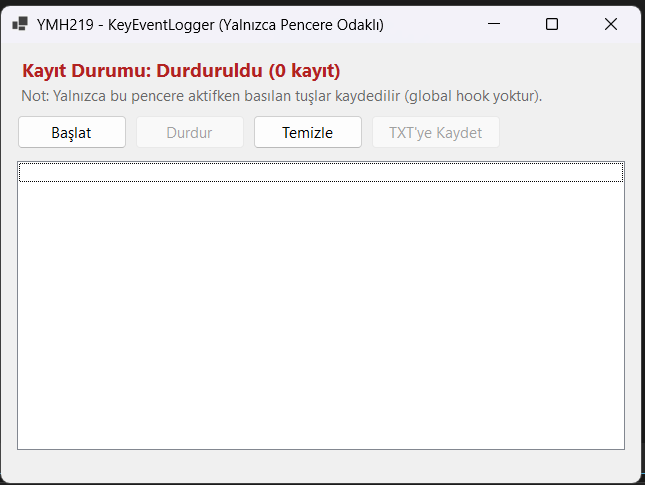

# YMH219-KeyEventLogger

Nesne Tabanli Programlama (YMH 219) dersi kapsaminda gelistirilen, yalnizca uygulama penceresi odaktayken klavye olaylarini zaman damgasiyla kaydeden Windows Forms uygulamasidir.

## Kullanilan Teknolojiler
* C# ve .NET Windows Forms
* Visual Studio Insiders
* Harici NuGet paketi kullanilmamistir

## Kurulum ve Calistirma Adimlari
1. Depoyu bilgisayara klonlayin: git clone https://github.com/elifbaburhan/YMH219-KeyEventLogger.git
2. Proje cozumunu veya projesini Visual Studio ile acin.
3. Projeyi derleyip (Ctrl + Shift + B) calistirin (F5).

## Temel Ozellikler
* Yalnizca form odaktayken KeyDown ve KeyUp olaylarinin tus adi ve zaman bilgisiyle listelenmesi
* Baslat, Durdur, Temizle ve TXT'ye Kaydet kontrolleri ile canli kayit durumu gostergesi
* Global hook, arka plan calismasi veya ag gonderimi icermeyen guvenli kapsam

## Ekran Goruntuleri

## Bilinen Sinirlamalar / Gelistirme Notlari
* Kayitlar yalnizca pencere aktifken alinir; uygulama kapatildiginda otomatik kaydetme yapilmaz.

## Ogrenci Bilgileri
* **Ad - Soyad:** Elif Baburhan
* **Ogrenci Numarasi:** 250541022
